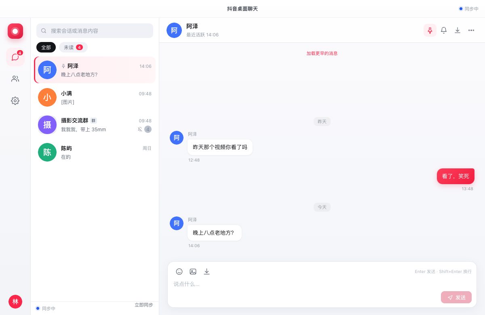
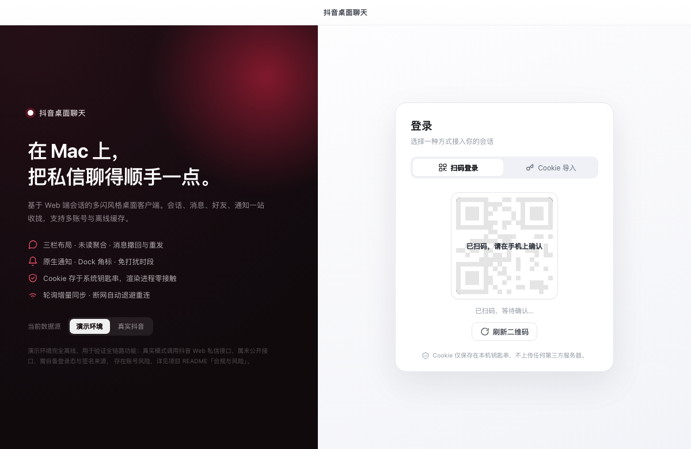
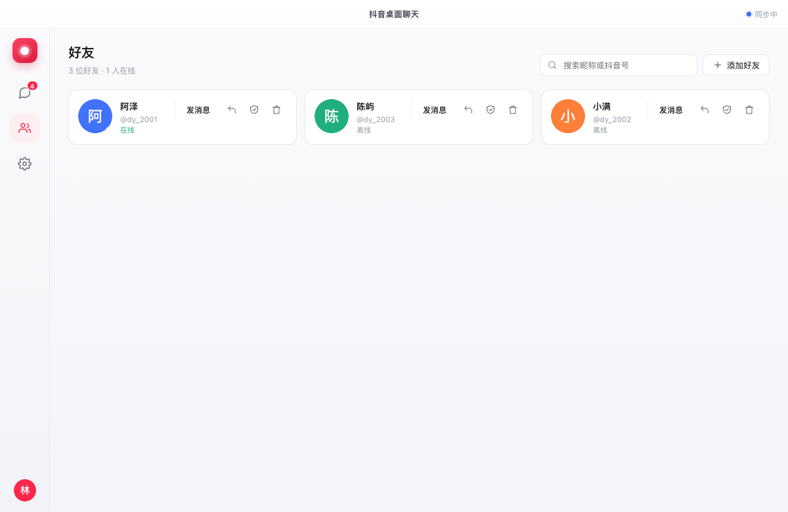
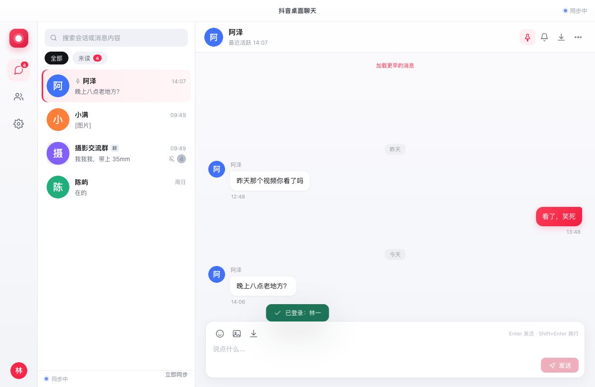

# 抖音桌面聊天（macOS）


在 Mac 上把抖音私信聊得顺手一点的桌面客户端。Electron + React + TypeScript，三栏布局，交互参照多闪。

**它解决什么问题**：网页版私信必须常驻一个浏览器标签页，切走就错过消息，也不能多账号并行。
这个客户端把私信搬成一个真正的桌面应用：独立窗口、原生通知、Dock 未读数、⌘⇧D 随时唤起、本地缓存可离线翻历史。

**两个数据源**
- **演示模式**：内置 mock 适配器，不需要账号，全链路（登录/收发/撤回/好友/通知/导出）都能跑通；
- **真实模式**：应用内扫码登录后，通过「页面传输」读取你**自己账号**的真实会话与消息（只读，见 §6.1）。

> ⚠️ 真实模式是用自动化方式访问抖音未公开接口，违反平台用户协议，有被限流/封号风险，
> 只建议在自己的账号上只读使用。本项目不提供任何绕过风控、伪造签名或抓取他人数据的能力。

> **直接下载**：[Releases](https://github.com/xmgzxmgz/douyin-chat-mac/releases/latest) ·
> macOS `douyin-chat-*-mac-arm64.dmg` / Windows `douyin-chat-*-win-x64.exe` / Linux `douyin-chat-*-linux-x86_64.AppImage`



> 截图使用内置演示数据，非真实账号内容。

---

## 先说清楚：关于「调用 Web 端抖音接口」

抖音**没有公开**第三方可用的私信（IM）接口。所谓「Web 端接口」是网页内部使用的私有接口，特点是：

- 无文档、无版本承诺，端点会随前端发版变化；
- 必须携带登录态 Cookie，并要求由页面 JS 计算的签名参数（`a_bogus` / `msToken` 等）；
- 自动化访问可能违反用户协议，存在账号被限流或封禁的风险。

因此本项目做了两件事：

1. **把协议层做成可插拔适配器**：`ChatAdapter` 接口 + 统一的 `wire.ts` 归一化层。
2. **内置一个完全离线的演示适配器（Mock）**：登录、会话、收发、撤回、好友、通知、导出全链路可跑通，
   不需要任何账号，也不访问任何第三方服务。

真实适配器有两条路，最终采用的是第二条：

1. `DouyinWebAdapter`：早期按 `www.douyin.com/aweme/v1/web/im/*` 实现，实测**端点不存在**（网关返回
   `Unsupported path(Janus)`），已作废；
2. **`DouyinPageAdapter`（当前使用）**：真实接口是 `imapi.douyin.com` 的 **protobuf**，但网关要求一个
   **页面侧运行时生成的 token**（缺失时报 `empty token`），它不在 Cookie、localStorage 或任何请求头里。
   于是改成「**把网页当传输层**」：用已登录的隐藏窗口打开私信页，让页面自己发请求，
   客户端通过 CDP 读回响应体再解码。**不读浏览器 Cookie、不逆向 token、不伪造签名。**

> **2026-11-10 实机验证**：真实账号登录后，`adapter` 从页面捕获到
> **121 个会话 / 1504 条消息 / 111 个昵称**，会话标题、消息气泡、时间线在界面中正常渲染。
> **发送已打通**：不再伪造 `imapi` 请求，而是驱动页面本身完成「点开会话 → 输入 → 提交」
> （见 [§3.1.3](docs/接口与合规.md)）。2026-11-10 16:19 实测发出并被页面确认，输入框清空、对方会话预览更新。

---

## 1. 项目范围

### 1.1 范围内

| 模块 | 能力 |
| --- | --- |
| 登录鉴权 | Cookie 导入、扫码登录（演示）、登录态加密保存与恢复、失效检测、退出登录、账号切换 |
| 会话列表 | 按置顶 + 时间排序、未读/提及计数、搜索、全部/未读筛选、置顶、免打扰、隐藏、草稿、右键菜单 |
| 消息收发 | 文本/图片（消息自带预览图）/文件/表情（真实贴纸）/语音（可播放 + 转写文本）/分享卡片、乐观发送、串行队列、失败重试、撤回、引用回复、历史分页、去重、已读水位 |
| 好友管理 | 好友列表、本地 + 远端搜索、添加、备注、拉黑、删除、在线状态 |
| 通知提醒 | 原生通知、点击跳转会话、Dock 角标、免打扰时段（支持跨零点）、免打扰会话、关闭预览、提示音开关 |
| 设置 | 数据源切换、同步间隔、分页大小、发送快捷键、关闭到托盘、开机自启、缓存清理 |
| 系统集成 | 菜单栏托盘、全局快捷键 `⌘⇧D`、单实例、导出聊天记录（Markdown） |

### 1.2 范围外（明确不做）

- 群发、营销、批量加好友等运营向能力；
- 抓取他人数据、绕过平台风控、伪造设备指纹/签名；
- 语音/视频通话、直播、Feed 浏览等非 IM 能力；
- 云同步与多端消息漫游（数据只在本机）。

### 1.3 已知限制

| 限制 | 原因 | 现状 |
| --- | --- | --- |
| 图片只显示消息自带的预览图，不是原图 | 抖音图片 CDN（ImageX）返回的是加密流，直接下载是密文，只有页面自己的解密器能还原 | 预览图足够辨认内容；点开原图会打不开 |
| 语音转文字依赖服务端已有结果 | 本机 whisper 模型下载被网络拦截，无法离线转写 | 在抖音里对该语音点过「转文字」后，客户端会显示 `ai_audio_text` |
| 发送表情需要到抖音窗口里点选 | 收藏表情是页面里的私有面板，没有稳定的对外接口 | 后续可做「打开表情面板」按钮，由用户在官方面板里选 |

---

## 2. 技术选型

| 层次 | 选择 | 理由 |
| --- | --- | --- |
| 桌面壳 | Electron 33 | macOS 生态成熟，原生通知/托盘/角标/钥匙串齐备，前端复用成本低 |
| UI | React 18 + TypeScript 5 | 组件化；严格类型让 IPC 契约和领域模型可校验 |
| 构建 | electron-vite 5（Vite 5） | 主进程/预加载/渲染进程一套配置，HMR 快，产物干净 |
| 状态 | 自研 reducer + `useSyncExternalStore` 风格单 store | 聊天状态耦合度高，避免引入额外状态库的心智负担 |
| 持久化 | 单文件 JSON + 原子替换（`state.json`） | **零原生依赖**，`npm install` 不需要重编译，任何 Mac 一次装好 |
| 敏感数据 | `safeStorage`（Keychain 支撑的 AES-GCM） | Cookie 不进渲染进程、不明文落盘 |
| 测试 | Vitest 2 | 纯 Node 环境直跑主进程逻辑，无需启动 GUI |
| 打包 | electron-builder 25 | 产出 `.app` 与 `.dmg`（arm64 + x64） |

**为什么不用 better-sqlite3**：Electron ABI 需要 `electron-rebuild`，在 CI/新机器上经常编译失败。
本项目的消息量级（单会话保留 2000 条）用 JSON 完全够用，换来的是「一次 `npm install` 必成功」。
若要支撑更大数据量，见 §9 的迁移建议。

---

## 3. 架构

```
src/
├── main/                       主进程（Node 环境，无 DOM 依赖）
│   ├── index.ts                生命周期、窗口/托盘/快捷键、事件广播
│   ├── ipc.ts                  IPC 白名单通道 → ChatService（统一 Result 包装）
│   ├── window.ts               主窗口、外链拦截、导航拦截
│   ├── notification.ts         原生通知 + Dock 角标
│   ├── adapters/
│   │   ├── types.ts            ChatAdapter 契约
│   │   ├── wire.ts             线上协议 → 领域模型（数字枚举/秒级时间/JSON 载荷）
│   │   ├── mock/               离线模拟后端（故障注入、扫码状态机、自动回复）
│   │   └── douyin/             真实适配器：端点表、HTTP 客户端、签名注入点
│   ├── core/
│   │   ├── chat-service.ts     应用服务门面（唯一状态源）
│   │   ├── send-queue.ts       串行发送 + 指数退避重试
│   │   ├── sync-engine.ts      轮询增量同步、失败退避、失效停机
│   │   ├── notification-policy.ts  纯函数通知决策（可单测）
│   │   ├── errors.ts           AppError + 可重试判定
│   │   └── notifier.ts         Notifier 接口 / 内存实现 / Logger
│   ├── store/repository.ts     JSON 持久化仓储
│   ├── security/               Keychain 凭据保险箱 / 内存实现
│   └── logging/                electron-log 封装
├── preload/index.ts            contextBridge 暴露受限 API
├── renderer/                   React UI（登录、会话、聊天、好友、设置）
└── shared/                     领域模型 + IPC 契约（主/渲染共用）
```

数据流：

```
UI 操作 → IPC → ChatService → ChatAdapter → (Mock | 抖音 Web)
                      │
                      ├─ Store（乐观落库 / 去重 / 已读水位）
                      ├─ SendQueue（串行 + 重试）
                      ├─ SyncEngine（增量拉取）
                      └─ Notifier（策略判定后弹通知）
                      ↓ AppEvent 广播
                    Renderer 更新视图
```

关键设计：

- **单一状态源**：所有会话/消息状态只在主进程维护，渲染层是投影，避免两端状态漂移。
- **乐观 UI**：发送先落库为 `sending`，服务端回执后按 `clientId` 合并为 `sent`，失败保留 `failed` 可重试。
- **已读水位**：会话记录 `readAt`，服务端返回的旧未读不会「回涨」，避免刷新后又出现小红点。
- **首次同步静默**：登录后第一次拉取只补历史、不补通知，避免瞬间弹出几十条历史提醒。
- **通知抑制**：窗口聚焦且正在看该会话 → 不弹；免打扰会话/时段 → 不弹但保留未读与角标。

---

## 4. 运行环境

| 项 | 要求 |
| --- | --- |
| 系统 | macOS 12 Monterey 及以上（Apple Silicon / Intel 均可） |
| Node.js | ≥ 20（推荐 22 LTS） |
| npm | ≥ 10 |
| 磁盘 | 依赖约 350 MB；打包产物约 100 MB |
| 内存 | 常驻约 250–350 MB |
| 网络 | 仅安装依赖时需要；演示模式运行期完全离线 |

本次验证环境：macOS 27.2（Darwin 27.2.0，arm64）、Node 22.22.2、npm 10.9.7、
Electron 33.4.11（Chromium 130.0.6723.191 / Node 20.18.3）。

---

## 5. 安装与运行

```bash
cd douyin-chat-mac

# 1) 安装依赖
npm install

# 2) 开发模式（HMR）
npm run dev

# 3) 生产构建 + 本地预览
npm run build
npm start
```

### 5.1 依赖与镜像

Electron 二进制默认从 GitHub 下载。国内网络可在 `.npmrc` 中指定镜像（仓库已内置）：

```ini
registry=https://registry.npmjs.org/
electron_mirror=https://npmmirror.com/mirrors/electron/
```

若 `npm install` 因网络中断失败，重跑即可（有缓存）。若 Electron 二进制缺失：

```bash
node node_modules/electron/install.js
```

### 5.2 打包（macOS / Windows / Linux）

三端都能在 Mac 上交叉编译，不需要额外装虚拟机：

```bash
npm run dist:mac     # .dmg（arm64 + x64）
npm run dist:win     # Windows 安装包 .exe（x64）
npm run dist:linux   # AppImage + tar.gz（x64）
npm run dist:all     # 三端一起出
```

| 平台 | 产物 | 说明 |
| --- | --- | --- |
| macOS | `douyin-chat-<ver>-mac-arm64.dmg` / `-mac-x64.dmg` | Apple Silicon / Intel |
| Windows | `douyin-chat-<ver>-win-x64.exe` | NSIS 安装包，可选安装目录 |
| Linux | `douyin-chat-<ver>-linux-x86_64.AppImage` | `chmod +x` 后直接运行 |

> 交叉编译 Windows 包时没有 wine，`electron-builder.yml` 里设了
> `signAndEditExecutable: false` 跳过 rcedit（代价是 exe 的图标/版本信息不被改写）。
> 想要「原生」产物用仓库里的 GitHub Actions（`.github/workflows/release.yml`），
> 三个平台各自在对应 runner 上构建：推 `v*` 标签即触发。

> 默认不做代码签名（`CSC_IDENTITY_AUTO_DISCOVERY=false`）。macOS 首次打开如提示「无法验证开发者」，
> 右键 → 打开，或执行 `xattr -dr com.apple.quarantine "抖音桌面聊天.app"`。
> Windows 首次运行 SmartScreen 会拦，点「更多信息 → 仍要运行」。

### 5.3 平台差异

| 能力 | macOS | Windows | Linux |
| --- | --- | --- | --- |
| 窗口装饰 | 内嵌红绿灯（`hiddenInset`） | 系统标题栏 | 系统标题栏 |
| 托盘 | ✅ | ✅ | 依赖 `libappindicator3`，不可用时自动跳过 |
| 通知 | ✅ | ✅（已设 AppUserModelID） | 依赖桌面通知服务 |
| 分享预览窗 | ✅ | ✅ | ✅ |
| 真实模式（页面传输） | ✅ | ✅ | ✅（Chromium 同源行为一致） |

---

## 6. 首次配置

1. 启动后进入登录页，确认左下角「当前数据源」为 **演示环境**；
2. 点「使用演示账号快速体验」，或等待二维码自动确认（演示环境约 3 秒）；
3. 登录后即可看到 4 个会话、3 位好友；发消息后对方会自动回复，用于验证收发与通知。

### 6.1 接入真实账号（只读同步，风险自担）


> 所有截图均使用应用内置的**演示数据**（`mock` 适配器），不含任何真实聊天内容。

1. 登录页左下角切到 **真实抖音** → 「Cookie 导入」标签；
2. 点 **在应用内登录抖音**：会弹出抖音网页，扫码/登录后窗口自动关闭；
3. 应用从**自己的 session 分区**读取 Cookie（不读你浏览器的配置），保存到钥匙串，
   然后启动「页面传输」通道，几秒后真实会话就会出现在左侧列表。

**为什么是「页面传输」而不是直接请求**：`imapi.douyin.com` 的请求体里有一个**页面运行时生成的
token**（缺失时网关返回 `empty token`），它不在 Cookie、localStorage 或任何请求头里
（实测请求头只有 `Accept / Content-Type / Referer / User-Agent / sec-ch-*`）。
所以客户端不去逆向它，而是让**页面自己发请求**，再用 Chromium 调试协议把响应体读回来解码：

```
隐藏窗口（已登录，persist:douyin-im 分区）
   └─ 打开 douyin.com/user/self?showTab=message
        └─ 页面自己带 token 请求 imapi.douyin.com（protobuf）
             └─ CDP：Network.loadingFinished → Network.getResponseBody
                  └─ ImCollector 容错解码（不绑定端点，按字段结构识别会话与消息）
```

| 能力 | 状态 |
| --- | --- |
| 真实会话列表（真实昵称 + 头像）、每个会话最近约 20 条消息 | ✅ 已启用 |
| 文案/图片/表情贴纸/语音/视频与图文分享卡片（可点击打开原链接） | ✅ 已启用 |
| 增量同步（页面持续轮询，捕获到新消息立即入库） | ✅ 已启用 |
| 好友列表（由私信会话反推） | ✅ 已启用 |
| 发送 / 撤回 / 已读上报 / 拉黑 / 搜索 | ⛔ 未启用（请求体字段未验证），调用明确返回 `UNSUPPORTED` |

> 表情面板（发送贴纸）同样受限于发送未启用；**接收到的表情贴纸会正常显示为图片**。

关闭应用后再次启动会**自动恢复真实账号**并从上次的游标继续同步。

Cookie 使用系统钥匙串加密后存于
`~/Library/Application Support/douyin-chat-mac/secure/credentials.bin`（权限 0600），
渲染进程无法读取原文。页面传输使用的会话分区在
`~/Library/Application Support/douyin-chat-mac/Partitions/douyin-im/`，与你的浏览器完全隔离。

> ⚠️ 这仍然是未公开接口 + 自动化访问，属于违反平台用户协议的高风险用法，
> 可能被限流或封号。只建议在你自己的账号上、只读使用。

### 6.2 真实接口排障（`npm run probe`）

真实 IM 走 `imapi.douyin.com` 的 protobuf 接口，**不需要签名参数**，关键是「端点 + 登录态」。按下面三步确认：

```bash
# ① 验证 Cookie 是否有效（打真实端点 /aweme/v1/web/user/profile/self/）
npm run probe -- --cookie-file ~/Desktop/dy-cookie.txt

# ② 一次性导出所有真实端点（推荐：DevTools → Save all as HAR with content）
npm run probe -- --har ~/Desktop/douyin.har --json > endpoints.json

# ③ 单条请求回放，验证某个接口是否可用
npm run probe -- --curl ~/Desktop/req.txt --times 3 --interval 2000
```

直达 IM 网关验证会话（最关键的一条）：

```bash
npm run probe -- --im-ping --cookie-file ~/dy-cookie.txt
# status=0            → 会话可用，可以接只读真实模式
# unexepcted session  → Cookie 不完整或 sessionid 无效
```

抓包方法：浏览器登录 → 打开私信 → 操作一遍（点开会话、发消息）→
DevTools → Network → 右键 → **Save all as HAR with content**。
注意用 **Chrome** 导出：Safari 会剥离 Cookie，并把 protobuf 请求体按 UTF-8 转码（无法回放）。

报告默认**隐藏 Cookie 值与签名参数值、不输出消息正文**，可直接分享。
若 `--im-ping` 返回 `status=0`，说明会话可用；此时应用内登录即可直接拉到会话。

> 这条路能解决「路径不对」和「字段不对」，**不能**解决「签名需要实时生成」。
> 后者只有两个合法选项：使用一次性抓包做只读验证，或走官方开放平台。

---

## 7. 使用要点

| 操作 | 方式 |
| --- | --- |
| 唤起窗口 | `⌘⇧D`（全局）或点击菜单栏图标 |
| 发送 | `Enter`；`⇧Enter` 换行（可在设置改为 `⌘+Enter` 发送） |
| 回复某条 | 悬停消息 → 回复图标 |
| 撤回 | 悬停自己的消息 → 刷新图标（2 分钟内） |
| 会话菜单 | 右键会话，或悬停右上角「⋯」 |
| 关闭窗口 | 默认收进菜单栏继续同步（设置可关） |
| 导出记录 | 会话菜单 / 会话头部下载图标 → Markdown |

---

## 8. 测试与验证结果

```bash
npm run typecheck   # TypeScript 严格模式，0 error
npm test            # Vitest，10 个文件 / 119 个用例
npm run build       # 主进程 + 预加载 + 渲染进程产物
npm run verify      # 上述三步串跑
```

| 测试文件 | 用例数 | 覆盖内容 |
| --- | --- | --- |
| `tests/unit/wire.test.ts` | 16 | 秒/毫秒时间、会话 ID、载荷编解码、消息与会话归一化、撤回 |
| `tests/unit/send-queue.test.ts` | 6 | 串行顺序、可重试/不可重试、重试耗尽、手动重试 |
| `tests/unit/notification-policy.test.ts` | 14 | 聚焦/失焦、自己/系统消息、免打扰会话、跨零点时段、正文摘要 |
| `tests/unit/store.test.ts` | 11 | 排序、本地标记不被覆盖、已读水位、去重、裁剪、持久化、损坏恢复 |
| `tests/unit/douyin-http.test.ts` | 11 | 公共参数与签名、Cookie/CSRF 头、解包、401/429/5xx/超时、缺签名 |
| `tests/unit/douyin-adapter.test.ts` | 10 | Cookie 校验、资料、会话/历史归一、增量游标、发送编码、撤回 |
| `tests/unit/im-collector.test.ts` | 11 | 容错解码（不绑端点）、去重、自他判定、昵称补全、脏数据不抛错 |
| `tests/integration/chat-flow.test.ts` | 18 | 登录装载、发送、收消息/通知/角标、故障重试、撤回、分页、好友、导出、重启恢复、账号切换、登出 |
| `tests/unit/im-protobuf.test.ts` | 14 | IM protobuf 编码（golden bytes）、响应解码、表情/分享/语音富内容解析 |
| `tests/integration/auth.test.ts` | 8 | 无效/过期 Cookie、扫码状态机、同步中失效、登出后鉴权 |

**结果：10 个文件全部通过，119/119 用例通过（约 11s）。**

人工/运行时验证：

| 项目 | 结果 |
| --- | --- |
| `npm run typecheck` | 通过，0 error |
| `npm run build` | 通过（main 93.9 kB / preload 3.6 kB / renderer 300 kB） |
| 开发构建启动 | 通过，窗口正常渲染 |
| 打包后 `.app` 启动 | 通过，图标/数据恢复正常 |
| DMG 打包 | 通过（arm64 99.5 MB、x64 104 MB） |
| UI 冒烟：登录 → 发消息 → 收到自动回复 → 未读清零 | 通过（见 `docs/screenshots/chat.png`） |

界面截图（均为真实运行截图，非设计稿）：

| 登录 | 好友 | 设置 |
| --- | --- | --- |
|  |  |  |

> 说明：截图中的二维码为演示环境生成的占位图形，非真实登录码。

---

## 9. 已知限制

1. **真实模式只读**：会话、消息、昵称、增量同步已实测可用；**发送 / 撤回 / 已读上报 / 拉黑 / 搜索未启用**，
   它们的 protobuf 请求字段尚未验证。与其给出「本地显示成功、对方收不到」的假功能，不如明确返回 `UNSUPPORTED`。
   补齐发送只需一条真实的 `/v1/message/send` 抓包（见 §6.2 的 `--curl` 用法）。
2. **页面传输依赖前端结构**：靠 `user/self?showTab=message` 触发 IM 初始化，并靠响应结构（而不是端点路径）
   识别会话与消息。平台改版后可能失效，届时调整 `ROUTE_CANDIDATES` 与解码规则即可。
3. **常驻一个隐藏窗口**：这是拿到页面 token 的代价。窗口不显示、不响应鼠标、静音；
   关闭它等于停止同步。
4. **昵称覆盖率不是 100%**：昵称来自页面另一路 JSON 资料，少数用户拿不到时退化为「抖音用户 + uid 后四位」。
5. **存储规模**：单文件 JSON + 原子替换，单会话保留 2000 条；十万级消息建议迁移 SQLite（接口已收敛在 `Store`）。
6. **未签名应用**：本机打包未做 Apple 公证，首次打开需在「系统设置 → 隐私与安全性」里允许。
